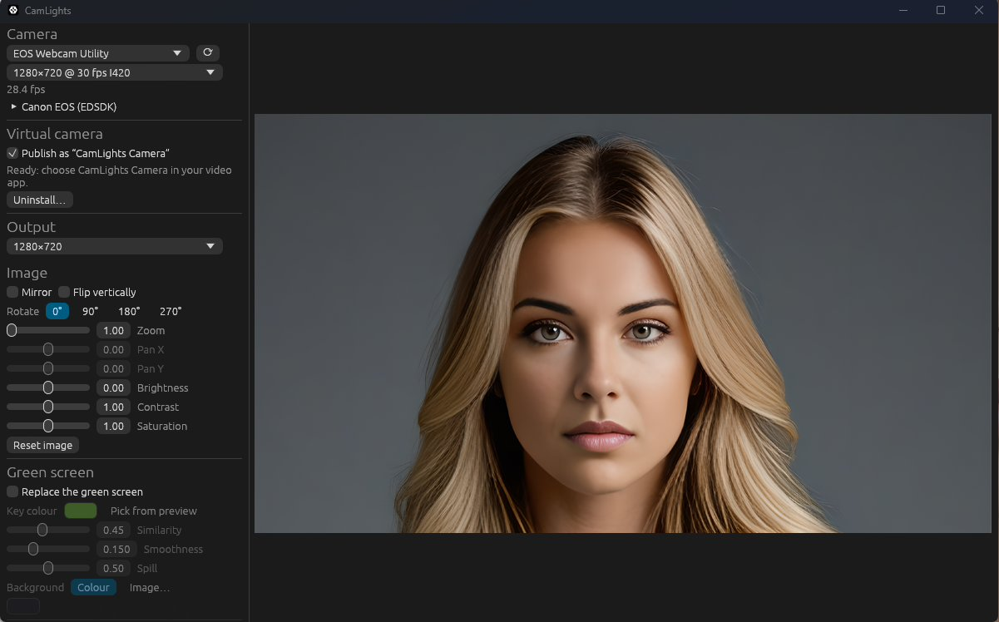

<div align="center">

# CamLights

**Webcam effects and a virtual camera for Windows 11, written in Rust.**

[](https://github.com/pdinsd/CamLights/actions/workflows/ci.yml)
[](https://github.com/pdinsd/CamLights/releases/latest)
[](LICENSE)
[](#requirements)
[](https://www.rust-lang.org/)
[](#roadmap)
[](https://github.com/pdinsd/CamLights/commits/main)

<br>



</div>

---

## About

CamLights takes the video from your webcam, capture card or camera, lets you adjust and decorate it, and publishes the result as **CamLights Camera**, a virtual camera that video-calling apps, browsers and softphones can select like any other webcam.

Everything runs locally on your PC. CamLights has no account, no cloud service and no telemetry.

### Features

- **Any Windows camera as input:** USB webcams, HDMI capture cards and camera vendor webcam drivers, with resolution and frame rate selection. Tested with a Canon EOS M50 through Canon EOS Webcam Utility.
- **Canon EOS live view (experimental):** connect directly to Canon EOS cameras over USB through Canon's EDSDK, which you supply yourself (see [Requirements](#requirements)).
- **Image controls:** mirror, flip, rotate, zoom and pan, brightness, contrast, saturation, and output resolution up to 1080p.
- **Green screen:** chroma key with an eyedropper, adjustable similarity, edge smoothness and spill removal; replace the screen with a solid colour or any image.
- **Overlays:** text captions (any colour, optional background box) and PNG/JPEG images with transparency, positioned by dragging them in the preview.
- **Virtual camera:** a native Windows 11 virtual camera, so no driver is installed. It exists only while CamLights is running.
- **Remembers your setup:** camera, format, effects and overlays are restored on the next start.

## Requirements

### To run CamLights

| | |
|---|---|
| **Operating system** | Windows 11, 64-bit (x64). The virtual camera uses `MFCreateVirtualCamera`, which Windows 10 does not provide. |
| **Camera** | Any camera that Windows lists as a webcam, or a supported Canon EOS camera with EDSDK. |
| **Administrator rights** | Once, to install the virtual camera. Day-to-day use needs none. |
| **Canon EDSDK** *(optional)* | Only for direct Canon EOS connections. EDSDK is not redistributable, so it is not included: request it from Canon's developer programme and point CamLights at the folder containing `EDSDK.dll`. |

No Visual C++ redistributable is needed: release builds link the C runtime statically.

### To build from source

- [Rust](https://rustup.rs/) stable, `x86_64-pc-windows-msvc` toolchain (developed with Rust 1.99)
- Visual Studio 2022 or the Build Tools for Visual Studio, with the **Desktop development with C++** workload (MSVC linker and Windows SDK)
- PowerShell 7 to run the packaging script

## Installation

### Installer (recommended)

1. Download `CamLights-Setup-<version>.exe` from the [latest release](https://github.com/pdinsd/CamLights/releases/latest).
2. Run it and approve the administrator prompt. Setup installs CamLights, adds it to the Start menu and installs the virtual camera.
3. Start CamLights and choose **CamLights Camera** in your video app.

Uninstall from **Settings → Apps**; this also removes the virtual camera.

### Portable zip

1. Download `CamLights-<version>.zip` from the [latest release](https://github.com/pdinsd/CamLights/releases/latest) and extract it anywhere.
2. Run `CamLights.exe`, then [install the virtual camera](#install-the-virtual-camera).

The release binaries are not code-signed yet, so Windows SmartScreen may warn on first launch: choose **More info → Run anyway**.

### Build and package

```powershell
git clone https://github.com/pdinsd/CamLights.git
cd CamLights
.\scripts\package.ps1
```

The script builds a release and writes `dist\CamLights-<version>.zip`, plus `dist\CamLights-Setup-<version>.exe` when [Inno Setup 6](https://jrsoftware.org/isinfo.php) is installed (from [`installer/CamLights.iss`](installer/CamLights.iss)). The zip contains:

| File | Purpose |
|---|---|
| `CamLights.exe` | The application. |
| `camlights_vcam.dll` | The virtual camera. Keep it next to `CamLights.exe`. |

Extract the archive anywhere, for example `C:\Program Files\CamLights` or a folder in your user profile, and run `CamLights.exe`.

### Install the virtual camera

1. Start CamLights.
2. Under **Virtual camera**, click **Install…** and approve the administrator prompt.
3. In your video app, choose **CamLights Camera** as the camera.

The installer copies the DLL to `C:\Program Files\CamLights\VirtualCamera\` and registers it there, so the folder you run CamLights from can change later. After upgrading CamLights, the panel offers **Update…** when the installed virtual camera differs from the new build.

To remove it, click **Uninstall…** in the same panel.

### Run from source during development

```powershell
cargo build          # builds the app and the virtual camera DLL
cargo run -p camlights
cargo test
```

Debug builds open a console window with logs; release builds do not.

## Usage

| Section | What it does |
|---|---|
| **Camera** | Choose the input camera and its format. The frame rate is shown below. Expand **Canon EOS (EDSDK)** to choose an EDSDK folder. |
| **Virtual camera** | Install, update or uninstall CamLights Camera, turn publishing on or off, and see whether an app is watching. |
| **Output / Image** | Output resolution and image controls. |
| **Green screen** | Enable keying, click **Pick from preview** then your screen in the preview, and tune the sliders. Choose a colour or an image background. |
| **Overlays** | Add text or images, then drag them in the preview or use the sliders. |

The preview shows exactly what other apps receive.

## Troubleshooting

| Problem | What to try |
|---|---|
| *"Hardware MFT failed to start streaming due to lack of hardware resources"* | Another program is using the camera. Close it (or the other CamLights window) and select the camera again. |
| The camera list is missing a camera | Click ⟳. Cameras that only provide a DirectShow driver are not supported yet. |
| A Canon camera does not appear | Check that the EDSDK folder is set and that EOS Utility, EOS Webcam Utility and similar apps are closed: only one program can control the camera. |
| Video apps show a grey picture | CamLights is not sending frames: make sure it is running with a camera selected and **Publish** is ticked. |
| The virtual camera says it is from a different build | Click **Update…**. |

Virtual camera diagnostics are written to `%ProgramData%\CamLights\vcam-*.log`.

## How it works

CamLights is a Cargo workspace:

| Crate | Responsibility |
|---|---|
| [`camlights`](crates/camlights) | The egui application and the capture thread. |
| [`camlights-core`](crates/camlights-core) | Frames, image processing, chroma key, overlays and NV12 conversion. |
| [`camlights-capture`](crates/camlights-capture) | Camera input through Media Foundation and Canon EDSDK. |
| [`camlights-vcam`](crates/camlights-vcam) | The virtual camera: a Media Foundation media source DLL loaded by the Windows Camera Frame Server. |
| [`camlights-vcam-shared`](crates/camlights-vcam-shared) | The shared-memory frame channel between the app and the virtual camera. |

The virtual camera runs inside the Windows Camera Frame Server service, not inside CamLights. The app sends it finished NV12 frames through shared memory at the resolution the receiving app selected, and the virtual camera shows a grey placeholder whenever no fresh frame is available.

## Roadmap

- AI background blur and replacement without a green screen
- Face-tracking props
- Nikon camera support
- DirectShow-only camera sources
- An application icon and a signed installer

## Contributing

Issues and pull requests are welcome. Please run `cargo test` and `cargo build` before opening a pull request, and describe how you tested camera or virtual camera changes.

## License

CamLights is released under the [Apache License, Version 2.0](LICENSE).

Unless you explicitly state otherwise, any contribution you intentionally submit for inclusion in this project shall be licensed under the Apache License 2.0, without any additional terms or conditions.

## Trademarks

Canon, EOS and EDSDK are trademarks of Canon Inc. Windows is a trademark of Microsoft Corporation. CamLights is an independent project and is not affiliated with or endorsed by these companies.
